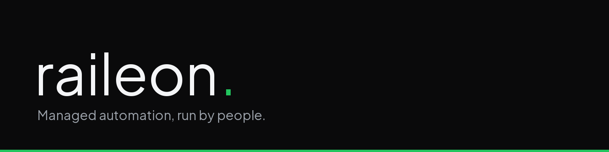

  

  <a href="https://raileon.com"><b>raileon.com</b></a> &nbsp;·&nbsp;
  <a href="https://github.com/SkyRaileon">@SkyRaileon</a> &nbsp;·&nbsp;
  <a href="https://raileon.com/tools/business-checkup">Free Business Checkup</a> &nbsp;·&nbsp;
  <a href="https://raileon.com/book">Book a call</a>

## Raileon

Software, automation, AI and training, under one roof. Raileon is a full-stack development company in Miami, Florida. We build the systems behind a business, inside the tools it already uses, and keep them running.

- **[Custom Software](https://raileon.com/custom-software-development):** private dashboards, customer portals, internal tools and links between your systems.
- **[Automation](https://raileon.com/business-process-automation):** lead follow-up, client intake, reporting and CRM updates, run and kept working by us.
- **[Custom AI Modules](https://raileon.com/ai-systems-development):** AI that knows your business and asks before anything important.
- **[LLM Development](https://raileon.com/llm-development):** an open model trained on your company's own data, running on your own systems.
- **[Team Training](https://raileon.com/services):** hands-on sessions so your people get the most from what we built.
- **[Raileon Social](https://raileon.com/social-media-management) and [Raileon Ads](https://raileon.com/ppc-management):** weekly posts, and ads tied to the calls and leads they bring in.

## Free tool

**[Business Checkup](https://raileon.com/tools/business-checkup):** see what's costing you customers on Google.

## Open source

- **[desktop-broom](https://github.com/Kastan97/desktop-broom):** an AI desktop organizer for Windows.

## Contact

[raileon.com](https://raileon.com) · hello@raileon.com · (786) 733-8337 · Miami, Florida
